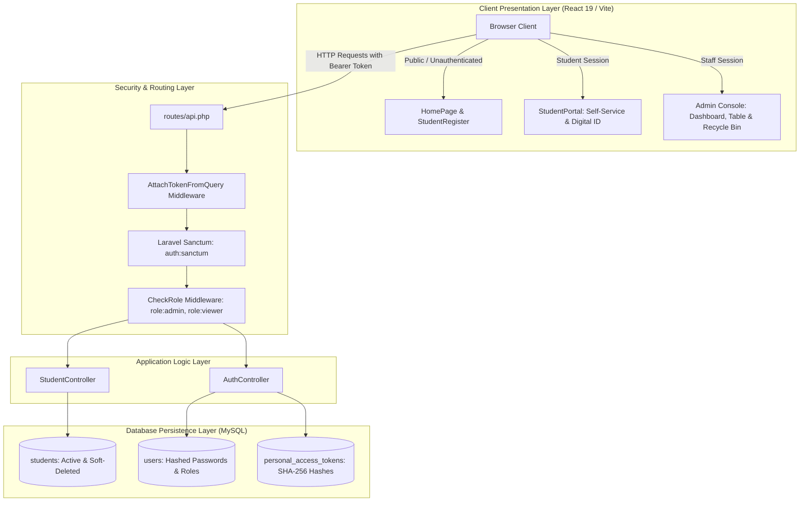
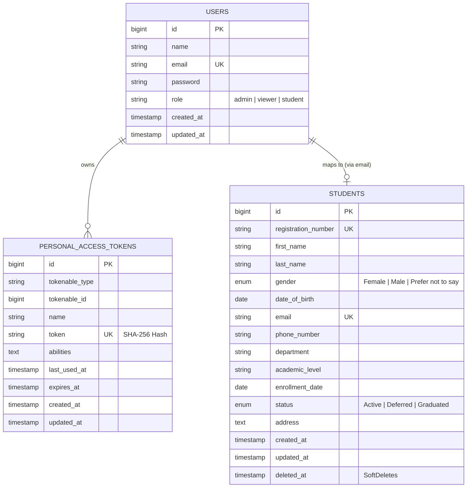

# Technical Architecture Document: Student Registration System

**Author:** Hana Abiyu  
**Project:** Student Registration System  
**Architecture Style:** Decoupled Client-Server RESTful SPA (Single Page Application)  
**Backend:** Laravel 11 / PHP 8.2+ / MySQL  
**Frontend:** React 19 / Vite / Modern Vanilla CSS Design Tokens  
**Authentication & Security:** Laravel Sanctum / Token-Based RBAC  

---

## 1. Executive Architecture Summary

The Student Registration System is engineered as a decoupled, multi-role web platform designed for academic registry management and student self-service. The system separates concerns between:

1. **A Stateless REST API Engine (Laravel 11):** Enforces data integrity, business constraints, role-based access control (RBAC), database indexing, server-side pagination, cryptographic password hashing, and streamed CSV exports.
2. **A Reactive Frontend Application (React 19 / Vite):** Delivers instantaneous user feedback, declarative view management, client-side validation, digital student credential cards, and responsive data tables.



---

## 2. The Request Lifecycle (The Journey of an HTTP Request)

To guarantee both high security and responsive performance, every network request follows a strict pipeline:

1. **Front-Door Bootstrap (`public/index.php` & `bootstrap/app.php`):**  
   The HTTP request enters the web server and initializes the Laravel framework container, loading routing tables, environment variables from `.env`, and exception renderers (enforcing JSON error formatting for all `/api/*` endpoints).
2. **Token Promotion Middleware (`AttachTokenFromQuery.php`):**  
   If a client requests a file download (such as `/api/students/export?token=...`) where the browser cannot attach custom HTTP headers, this middleware detects the query token and promotes it to a standard `Authorization: Bearer <token>` header before security guards execute.
3. **Authentication Barrier (`auth:sanctum`):**  
   Laravel Sanctum parses the `Authorization: Bearer <token>` header, extracts the plain token ID, and calculates its SHA-256 hash. It performs a lookup against `personal_access_tokens.token`. If missing or invalid, it short-circuits with an HTTP `401 Unauthorized`. If valid, it hydrates `$request->user()`.
4. **Role-Based Authorization Barrier (`CheckRole.php`):**  
   For administrative endpoints (such as `POST /api/students`, `DELETE /api/students/{id}`, or `GET /api/students/trashed`), the custom `role:admin` middleware checks `$request->user()->role`. If the user has a `viewer` or `student` role, the request is rejected immediately with an HTTP `403 Forbidden`.
5. **Controller Business Logic (`StudentController.php` / `AuthController.php`):**  
   The controller validates incoming parameters, performs database operations wrapped in database transactions where necessary, and delegates querying to Eloquent models.
6. **Persistence & Serialization:**  
   Eloquent executes optimized SQL queries (using parameter bindings, B-Tree indexes, and `LIMIT`/`OFFSET`). Results are serialized into JSON envelopes (such as `LengthAwarePaginator`) and returned with standard HTTP status codes (`200 OK`, `201 Created`, `204 No Content`, `422 Unprocessable Entity`).

---

## 3. Database Architecture & Data Dictionary



### Table 1: `students`
Primary repository of student personal and academic information.

| Column | Type | Nullable | Default | Constraints & Description |
| :--- | :--- | :---: | :---: | :--- |
| `id` | `BIGINT UNSIGNED` | No | Auto | Primary Key |
| `registration_number` | `VARCHAR(255)` | No | — | Unique institutional ID (e.g., `STU-2026-04812`). B-tree index. |
| `first_name` | `VARCHAR(255)` | No | — | Student given name |
| `last_name` | `VARCHAR(255)` | No | — | Student surname / family name |
| `gender` | `ENUM` | No | — | Allowed: `'Female'`, `'Male'`, `'Prefer not to say'` |
| `date_of_birth` | `DATE` | No | — | Validated server-side to ensure dates are strictly in the past |
| `email` | `VARCHAR(255)` | No | — | Unique academic email address. B-tree index. |
| `phone_number` | `VARCHAR(255)` | No | — | Contact telephone number (validated with regex) |
| `department` | `VARCHAR(255)` | No | — | Academic program / faculty (e.g., Computer Science) |
| `academic_level` | `VARCHAR(255)` | No | — | Current standing (e.g., `Year 1`, `Year 2`, `Postgraduate`) |
| `enrollment_date` | `DATE` | No | — | Date of institutional admission |
| `status` | `ENUM` | No | `'Active'` | Allowed: `'Active'`, `'Deferred'`, `'Graduated'` |
| `address` | `TEXT` | Yes | `NULL` | Residential / dormitory address |
| `created_at` | `TIMESTAMP` | Yes | `NULL` | Automatic audit timestamp |
| `updated_at` | `TIMESTAMP` | Yes | `NULL` | Automatic modification timestamp |
| `deleted_at` | `TIMESTAMP` | Yes | `NULL` | Soft-deletion flag. Indexed for fast exclusion from active queries. |

### Table 2: `users`
Authentication credentials, identity verification, and role assignments.

| Column | Type | Nullable | Default | Constraints & Description |
| :--- | :--- | :---: | :---: | :--- |
| `id` | `BIGINT UNSIGNED` | No | Auto | Primary Key |
| `name` | `VARCHAR(255)` | No | — | Full display name |
| `email` | `VARCHAR(255)` | No | — | Unique sign-in email address. B-tree index. |
| `email_verified_at`| `TIMESTAMP` | Yes | `NULL` | Email verification date |
| `password` | `VARCHAR(255)` | No | — | Bcrypt / Argon2id salted and hashed password string |
| `role` | `VARCHAR(255)` | No | `'viewer'`| Security role: `'admin'`, `'viewer'`, or `'student'` |
| `remember_token` | `VARCHAR(100)` | Yes | `NULL` | Stateful session token |
| `created_at` | `TIMESTAMP` | Yes | `NULL` | Creation timestamp |
| `updated_at` | `TIMESTAMP` | Yes | `NULL` | Modification timestamp |

### Table 3: `personal_access_tokens`
Cryptographically secured bearer tokens issued by Laravel Sanctum.

| Column | Type | Nullable | Constraints & Description |
| :--- | :--- | :---: | :--- |
| `id` | `BIGINT UNSIGNED` | No | Primary Key |
| `tokenable_type` | `VARCHAR(255)` | No | Morph class (`App\Models\User`) |
| `tokenable_id` | `BIGINT UNSIGNED` | No | Foreign Key referencing `users.id` |
| `name` | `VARCHAR(255)` | No | Token descriptor (`auth_token`) |
| `token` | `VARCHAR(64)` | No | Unique SHA-256 hash of the plain-text token |
| `abilities` | `TEXT` | Yes | JSON array of token permissions |
| `last_used_at` | `TIMESTAMP` | Yes | Updated automatically upon request authentication |
| `expires_at` | `TIMESTAMP` | Yes | Optional token expiry timestamp |

---

## 4. Deep-Dive Feature Implementations

### 1. Student Self-Registration Flow
* **Goal:** Enable incoming students to register online without manual administrator intervention, receiving an immediate authenticated session.
* **Backend Mechanism:** `AuthController::registerStudent()`:
  * Receives student details and account password via `POST /api/register-student`.
  * Validates email uniqueness across **both** `students` and `users` tables.
  * Executes a database transaction (`DB::transaction`):
    1. Generates an institutional ID format (`STU-YYYY-XXXXX`) and checks collisions.
    2. Persists the `Student` model with `status: 'Active'` and `enrollment_date: now()`.
    3. Persists the `User` model with `role: 'student'` and hashed password (`Hash::make()`).
    4. Issues a Sanctum token (`$user->createToken('auth_token')->plainTextToken`).
  * Returns HTTP `201 Created` with immediate login payload.
* **Frontend Mechanism:** [StudentRegister.jsx](file:///c:/Users/D/Desktop/Projects/student-registration-system/frontend/src/components/StudentRegister.jsx):
  * Multi-section responsive form verifying password confirmation and date of birth in the past.
  * On success, immediately writes `auth_token` and `user` to `localStorage` and routes the user into `<StudentPortal />`.

### 2. Dedicated Student Self-Service Portal
* **Goal:** Provide authenticated students with a dedicated private view of their own records, preventing unauthorized visibility into other students' profiles.
* **Backend Mechanism:** `StudentController::myProfile()` & `StudentController::updateMyProfile()`:
  * Resolves student record by matching `$request->user()->email`.
  * Allows students to safely update contact information (`phone_number`, `address`) while locking academic properties (`status`, `department`, `academic_level`, `registration_number`).
* **Frontend Mechanism:** [StudentPortal.jsx](file:///c:/Users/D/Desktop/Projects/student-registration-system/frontend/src/components/StudentPortal.jsx):
  * Renders a digital Student ID Card with institutional branding, initials avatar, ID badge, and standing.
  * Provides an inline contact information editor with instant save and error handling.

### 3. Server-Side Pagination
* **Goal:** Support enterprise-scale datasets with constant $O(1)$ network payloads and zero browser memory bloat.
* **Backend Mechanism:** `StudentController::index()`:
  * Reads `per_page` query parameter (defaulting to 10).
  * Executes Eloquent's `paginate($perPage)`, compiling SQL `SELECT * FROM students WHERE deleted_at IS NULL ORDER BY created_at DESC LIMIT 10 OFFSET 20`.
  * Wraps results in Laravel's `LengthAwarePaginator` JSON envelope (`current_page`, `last_page`, `total`, `from`, `to`, `data`).
* **Frontend Mechanism:** [StudentList.jsx](file:///c:/Users/D/Desktop/Projects/student-registration-system/frontend/src/components/StudentList.jsx) & [App.jsx](file:///c:/Users/D/Desktop/Projects/student-registration-system/frontend/src/App.jsx):
  * Manages `currentPage` and `pageSize` in React state.
  * Synchronizes pagination controls with backend query strings via `URLSearchParams`.
  * Computes dynamic windowed page numbering (`1 ... 4 5 6 ... 20`) with boundary-disabled Previous/Next buttons.

### 4. Multi-Field Search & Filter Querying
* **Goal:** Enable instant cross-column searching without boolean operator precedence bugs or SQL injection vulnerabilities.
* **Backend Mechanism:**
  * Uses parameter-bound nested closures:
    ```php
    $query->where(function ($q) use ($search) {
        $q->where('first_name', 'like', "%{$search}%")
          ->orWhere('last_name', 'like', "%{$search}%")
          ->orWhere('email', 'like', "%{$search}%")
          ->orWhere('registration_number', 'like', "%{$search}%");
    });
    ```
  * Ensures compiled SQL wraps search terms in parentheses: `WHERE status = ? AND (first_name LIKE ? OR ...)` preserving strict status/department filter isolation.

### 5. Soft Deletes & Recycle Bin Architecture
* **Goal:** Prevent accidental data loss and comply with academic record retention regulations by preserving deleted records in the database.
* **Backend Mechanism:**
  * `Student` model uses Laravel's `SoftDeletes` trait.
  * Calling `$student->delete()` updates the `deleted_at` timestamp rather than issuing an irreversible SQL `DELETE`.
  * `Student::onlyTrashed()` queries soft-deleted records for `GET /api/students/trashed`.
  * `Student::withTrashed()->findOrFail($id)->restore()` sets `deleted_at = NULL` to return the record to active status.
* **Frontend Mechanism:**
  * Admin header toggles between **Active Students** and **Recycle Bin**.
  * Shows dedicated Restore action buttons for soft-deleted students.

### 6. Streaming CSV Export with Dual Authentication
* **Goal:** Allow users to export large student datasets directly to `.csv` files without running out of server RAM or failing authentication.
* **Backend Mechanism:** `StudentController::exportCsv()`:
  * Uses `response()->stream()` with PHP's `php://output` and `fputcsv()`.
  * Leverages PDO cursor generators (`cursor()`) to iterate row-by-row in constant memory ($O(1)$ RAM).
  * Injects a UTF-8 Byte Order Mark (`\xEF\xBB\xBF`) so Microsoft Excel properly parses international characters.
  * Emits `Access-Control-Expose-Headers: Content-Disposition` so frontend scripts can read the server's generated filename.
* **Frontend Mechanism:** [api.js](file:///c:/Users/D/Desktop/Projects/student-registration-system/frontend/src/services/api.js#L193-L235):
  * Fetches the stream as a `Blob` using `getAuthHeaders()` (`Authorization: Bearer <token>`).
  * Creates an in-memory Object URL (`window.URL.createObjectURL(blob)`) and clicks an invisible `<a>` element to download directly to disk without navigating away.
  * Supported by `AttachTokenFromQuery` middleware for direct browser links with `?token=`.

### 7. Modal-Based Delete Confirmation Interceptor
* **Goal:** Prevent accidental student record deletions by intercepting delete actions with an accessible confirmation dialog, eliminating browser `window.confirm()` thread blocking.
* **Frontend Mechanism:** [DeleteConfirmationModal.jsx](file:///c:/Users/D/Desktop/Projects/student-registration-system/frontend/src/components/DeleteConfirmationModal.jsx):
  * Controlled via React state: `{ isOpen: boolean, student: object | null }`.
  * Traps keyboard `Escape` key and backdrop clicks.
  * Shows student name and registration number with an active `isDeleting` loading indicator.

---

## 5. Comprehensive Repository File Breakdown

### Backend Files (`backend/`)

| File Path | Component / Layer | Architectural Responsibility |
| :--- | :--- | :--- |
| [routes/api.php](file:///c:/Users/D/Desktop/Projects/student-registration-system/backend/routes/api.php) | Routing | Declares public, authenticated (`auth:sanctum`), and role-guarded (`role:admin`) API endpoints. Enforces static route precedence (`/trashed`, `/export`, `/restore` before `/{student}`). |
| [bootstrap/app.php](file:///c:/Users/D/Desktop/Projects/student-registration-system/backend/bootstrap/app.php) | Framework Kernel | Configures routing files, middleware pipelines (prepends `AttachTokenFromQuery`, registers `'role'` alias), and forces JSON error responses for API routes. |
| [app/Http/Controllers/AuthController.php](file:///c:/Users/D/Desktop/Projects/student-registration-system/backend/app/Http/Controllers/AuthController.php) | Controller | Handles `login()` (timing-safe verification, token issuance), `logout()` (token deletion), and `registerStudent()` (transactional creation of Student and User records). |
| [app/Http/Controllers/StudentController.php](file:///c:/Users/D/Desktop/Projects/student-registration-system/backend/app/Http/Controllers/StudentController.php) | Controller | Handles CRUD operations, `index()` (search, filter, pagination), `myProfile()` / `updateMyProfile()`, `dashboardStats()`, `trashed()`, `restore()`, and `exportCsv()`. |
| [app/Http/Middleware/CheckRole.php](file:///c:/Users/D/Desktop/Projects/student-registration-system/backend/app/Http/Middleware/CheckRole.php) | Middleware | Enforces backend RBAC. Compares `$request->user()->role` against required role, returning `401 Unauthorized` (if unauthenticated) or `403 Forbidden` (if role mismatched). |
| [app/Http/Middleware/AttachTokenFromQuery.php](file:///c:/Users/D/Desktop/Projects/student-registration-system/backend/app/Http/Middleware/AttachTokenFromQuery.php) | Middleware | Converts `?token=` query parameters into `Authorization: Bearer <token>` headers before Sanctum runs, enabling direct file downloads. |
| [app/Models/Student.php](file:///c:/Users/D/Desktop/Projects/student-registration-system/backend/app/Models/Student.php) | Eloquent Model | Defines fillable columns and enables `SoftDeletes` trait for audit-safe record retention. |
| [app/Models/User.php](file:///c:/Users/D/Desktop/Projects/student-registration-system/backend/app/Models/User.php) | Eloquent Model | Represents authenticated accounts (`admin`, `viewer`, `student`). Implements Sanctum's `HasApiTokens` and automatic password hashing. |
| [database/migrations/2026_11_06_102704_create_students_table.php](file:///c:/Users/D/Desktop/Projects/student-registration-system/backend/database/migrations/2026_11_06_102704_create_students_table.php) | Migration | Defines schema, constraints, unique keys, and enums for the `students` table. |
| [database/migrations/2026_11_10_175811_add_deleted_at_to_students_table.php](file:///c:/Users/D/Desktop/Projects/student-registration-system/backend/database/migrations/2026_11_10_175811_add_deleted_at_to_students_table.php) | Migration | Adds indexed `deleted_at` column to `students` table for soft deletes. |
| [database/migrations/2026_11_11_115100_add_role_to_users_table.php](file:///c:/Users/D/Desktop/Projects/student-registration-system/backend/database/migrations/2026_11_11_115100_add_role_to_users_table.php) | Migration | Adds `role` column (`admin`, `viewer`, `student`) to the `users` table. |
| [tests/Feature/StudentApiTest.php](file:///c:/Users/D/Desktop/Projects/student-registration-system/backend/tests/Feature/StudentApiTest.php) | Test Suite | 11 automated PHPUnit feature tests asserting authentication, RBAC (403 for viewers), validation (422), self-registration, my-profile, search, and CSV streaming. |

---

### Frontend Files (`frontend/src/`)

| File Path | Component / Layer | Architectural Responsibility |
| :--- | :--- | :--- |
| [App.jsx](file:///c:/Users/D/Desktop/Projects/student-registration-system/frontend/src/App.jsx) | Root Component | Top-level state coordinator: session management, declarative view switching (`home`, `register`, `login`, `portal`, `admin`), pagination state, and modal triggers. |
| [services/api.js](file:///c:/Users/D/Desktop/Projects/student-registration-system/frontend/src/services/api.js) | Service Layer | Centralized HTTP client: Bearer token injection, response handling, 401 session clearing, `registerStudent()`, `getMyProfile()`, and `exportStudentsCsv()` Blob streaming. |
| [components/HomePage.jsx](file:///c:/Users/D/Desktop/Projects/student-registration-system/frontend/src/components/HomePage.jsx) | View Component | Modern public landing page with 2-column institutional layout, student ID credential preview, numbered capability sections, and role-aware navigation. |
| [components/StudentRegister.jsx](file:///c:/Users/D/Desktop/Projects/student-registration-system/frontend/src/components/StudentRegister.jsx) | View Component | Multi-section student self-registration form with client-side validation and immediate authentication routing upon completion. |
| [components/StudentPortal.jsx](file:///c:/Users/D/Desktop/Projects/student-registration-system/frontend/src/components/StudentPortal.jsx) | View Component | Dedicated student dashboard: digital student ID badge, academic standing overview, and inline editable contact details (`phone_number`, `address`). |
| [components/StudentList.jsx](file:///c:/Users/D/Desktop/Projects/student-registration-system/frontend/src/components/StudentList.jsx) | Presentation Component | Server-side paginated student directory table, search bar, status/department filters, CSV download button, and role-conditioned Action buttons. |
| [components/StudentDetails.jsx](file:///c:/Users/D/Desktop/Projects/student-registration-system/frontend/src/components/StudentDetails.jsx) | View Component | Detailed profile view displaying full academic and personal attributes fetched via `GET /api/students/{id}`. |
| [components/StudentForm.jsx](file:///c:/Users/D/Desktop/Projects/student-registration-system/frontend/src/components/StudentForm.jsx) | Presentation Component | Administrative modal form for creating and updating student records with 11 validated inputs. |
| [components/DeleteConfirmationModal.jsx](file:///c:/Users/D/Desktop/Projects/student-registration-system/frontend/src/components/DeleteConfirmationModal.jsx) | Presentation Component | Accessible modal interceptor for student deletion confirming student name and ID before sending `DELETE`. |
| [components/Dashboard.jsx](file:///c:/Users/D/Desktop/Projects/student-registration-system/frontend/src/components/Dashboard.jsx) | Presentation Component | Metric summary cards (Total, Active, Deferred, Graduated, Trashed) and department breakdown loaded from `GET /api/dashboard-stats`. |
| [components/Login.jsx](file:///c:/Users/D/Desktop/Projects/student-registration-system/frontend/src/components/Login.jsx) | Presentation Component | Clean authentication form with password visibility, error alert banner, and shortcuts to register or return home. |
| [components/__tests__/](file:///c:/Users/D/Desktop/Projects/student-registration-system/frontend/src/components/__tests__/) | Test Suite | 5 Vitest component test suites (12 tests) verifying `<HomePage />`, `<StudentPortal />`, `<StudentList />`, `<DeleteConfirmationModal />`, and `<Login />`. |
