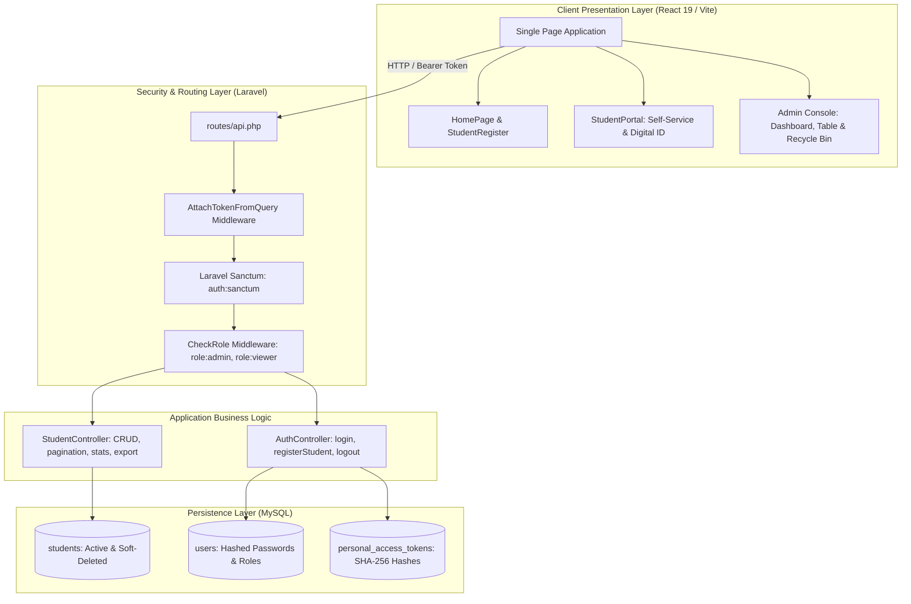

# Student Registration System

**Author / Developer:** Hana Abiyu  
**Contact:** hanaabiyu15@gmail.com  
**Repository Architecture:** Decoupled Client-Server RESTful SPA (Single Page Application)  
**Backend:** Laravel 11 / PHP 8.2+ / MySQL / Eloquent ORM  
**Frontend:** React 19 / Vite / Modern Vanilla CSS Design Tokens  
**Authentication & Security:** Laravel Sanctum / Token-Based Role-Based Access Control (RBAC)  

---

## 1. Executive Summary & Overview

The **Student Registration System** is an enterprise-grade academic registry platform engineered to manage student lifecycles from initial self-registration through graduation. Built with a decoupled architecture, the system provides high responsiveness, audit-safe record management, and granular multi-role security across three distinct user groups:

- **Students:** Public self-registration, instant authentication, digital student ID card presentation, and self-service contact updates.
- **Administrators (`admin`):** Complete management authority, including student CRUD, bulk CSV exports, real-time analytics, and soft-delete recovery via the Recycle Bin.
- **Auditors & Staff (`viewer`):** Read-only visibility into student directories, profile records, and aggregated analytics, with mutation endpoints strictly blocked.

For comprehensive architectural blueprints, database entity-relationship diagrams, and request lifecycle traces, see [ARCHITECTURE.md](ARCHITECTURE.md).

---

## 2. Key System Features

### 🎓 1. Public Student Self-Registration
- **End-to-End Registration Flow:** Prospective students register directly from the public landing page via `POST /api/register-student`.
- **Atomic Persistence:** A database transaction guarantees that both the `Student` record (with an auto-generated unique registration number `STU-YYYY-XXXXX`) and the corresponding `User` authentication account (`role: student`) are created atomically.
- **Zero-Friction Onboarding:** On successful registration, the API issues a Laravel Sanctum Bearer token, automatically signing the student into the portal without requiring an intermediate login step.

### 🪪 2. Dedicated Student Self-Service Portal
- **Role-Guarded Self-Service:** Authenticated students are routed to an exclusive portal view displaying their digital institutional identity badge, academic standing, and program details.
- **Scoped Record Isolation:** Powered by `GET /api/my-profile`, students can access only their own record, resolved directly from their authenticated token (`$request->user()->email`), preventing unauthorized profile probing.
- **Controlled Contact Updates:** Students can update their phone number and residential address (`PUT /api/my-profile`) while institutional properties (registration number, department, academic level, and status) remain immutable.

### 🛡️ 3. Role-Based Access Control (RBAC)
- **Three Core Roles:**
  - `admin`: Full read, create, update, delete, restore, and export access.
  - `viewer`: Read-only access to directories, details, dashboard stats, and CSV exports. All mutation requests return HTTP `403 Forbidden`.
  - `student`: Access restricted strictly to their personal self-service portal.
- **Multi-Tiered Enforcement:** Security is enforced both server-side (`CheckRole` middleware on API routes) and client-side (conditional rendering of action buttons and forms).

### ⚡ 4. Server-Side Pagination & High-Performance Querying
- **Constant Network Payload:** The `GET /api/students` endpoint utilizes Eloquent's `paginate()` with database-level SQL `LIMIT` and `OFFSET` clauses, returning a `LengthAwarePaginator` JSON envelope.
- **Client Synchronized Navigation:** The React frontend manages pagination state with windowed numeric controls (`1 ... 4 5 6 ... 20`), ensuring zero client-side browser memory degradation regardless of table size.
- **Multi-Field Search & Filter Querying:** Multi-column search across `first_name`, `last_name`, `email`, and `registration_number` uses nested parameter-bound closures to prevent SQL injection and boolean operator precedence bugs.

### ♻️ 5. Soft Deletes & Recycle Bin Recovery
- **Audit-Safe Record Retention:** Student deletions leverage Laravel's `SoftDeletes` trait, populating an indexed `deleted_at` timestamp rather than issuing an irreversible SQL `DELETE`.
- **Interactive Recycle Bin:** Administrators can switch to the Recycle Bin view (`GET /api/students/trashed`) and instantly restore records (`POST /api/students/{id}/restore`) back to active status.

### 📊 6. Database-Level Dashboard Metrics Aggregation
- **Zero-Memory Analytics:** The `GET /api/dashboard-stats` endpoint executes database aggregations (`count()`, `groupBy()`, `selectRaw()`) directly inside MySQL, returning pre-calculated statistics for active, deferred, graduated, and trashed students, as well as department distribution.

### 📥 7. Memory-Safe Streaming CSV Export
- **Constant Memory Footprint:** The `GET /api/students/export` endpoint leverages PHP's `response()->stream()` with PDO cursor generators (`cursor()`), streaming records in constant $O(1)$ memory without RAM spikes on enterprise datasets.
- **Dual Authentication Support:** Supports both `Authorization: Bearer <token>` via frontend `fetch()` + `response.blob()` and direct URL downloads with `?token=...` via the custom `AttachTokenFromQuery` middleware. Includes a UTF-8 BOM (`\xEF\xBB\xBF`) for Microsoft Excel compatibility.

### ⚠️ 8. Modal-Based Delete Confirmation Interceptor
- **Prevent Accidental Data Loss:** Replaces generic browser `window.confirm()` popups with an accessible, keyboard-trapped modal dialog displaying the target student's name and registration number, with active loading indicators during deletion.

---

## 3. Technology Stack

| Layer | Technologies & Tools |
| :--- | :--- |
| **Backend Framework** | Laravel 11.x, PHP 8.2+ |
| **Database & ORM** | MySQL 8.x / MariaDB, Eloquent ORM |
| **API Authentication** | Laravel Sanctum (Cryptographic SHA-256 Token Hashing) |
| **Frontend Framework** | React 19.x, Vite 8.x |
| **Routing & Architecture** | Single Page Application (SPA), State-Driven Routing, RESTful API |
| **Styling & Design** | Vanilla CSS Design Tokens, Responsive Flexbox & Grid, Accessible Forms |
| **Testing Frameworks** | PHPUnit 11 (Backend Feature & Unit), Vitest & React Testing Library (Frontend) |

---

## 4. System Architecture



---

## 5. Prerequisites & Environment Setup

Ensure you have the following installed on your machine:
- **PHP:** >= 8.2 with `pdo_mysql`, `mbstring`, `openssl` extensions enabled
- **Composer:** >= 2.x
- **Node.js:** >= 18.x and **npm:** >= 9.x
- **MySQL / MariaDB:** >= 8.0 (running locally via XAMPP, Laragon, or standalone)

---

## 6. Installation & Quick Start Guide

### Step 1: Clone Repository
```bash
git clone <repository-url>
cd student-registration-system
```

### Step 2: Backend Setup (Laravel)
1. Navigate to the `backend` folder:
   ```bash
   cd backend
   ```
2. Install PHP dependencies:
   ```bash
   composer install
   ```
3. Create environment configuration:
   ```bash
   cp .env.example .env
   ```
4. Configure database credentials inside `.env`:
   ```env
   DB_CONNECTION=mysql
   DB_HOST=127.0.0.1
   DB_PORT=3306
   DB_DATABASE=student_registration
   DB_USERNAME=root
   DB_PASSWORD=
   ```
   *(Note: Adjust `DB_PORT` to `3307` if using XAMPP configured on port 3307).*

5. Generate application cryptographic key:
   ```bash
   php artisan key:generate
   ```
6. Run migrations to initialize database schema:
   ```bash
   php artisan migrate
   ```
7. Start the Laravel development server:
   ```bash
   php artisan serve
   ```
   The backend API will run at: `http://127.0.0.1:8000`

---

### Step 3: Frontend Setup (React / Vite)
1. In a new terminal window, navigate to the `frontend` folder:
   ```bash
   cd frontend
   ```
2. Install Node dependencies:
   ```bash
   npm install
   ```
3. Start the Vite development server:
   ```bash
   npm run dev
   ```
   The application will be accessible at: `http://localhost:5173`

---

## 7. API Specification Reference

All endpoints return JSON responses with standard HTTP status codes (`200 OK`, `201 Created`, `204 No Content`, `401 Unauthorized`, `403 Forbidden`, `422 Unprocessable Entity`, `404 Not Found`).

| Method | Endpoint | Access Control | Purpose | Request Body / Parameters | Status Codes |
| :--- | :--- | :--- | :--- | :--- | :--- |
| `POST` | `/api/register-student` | Public | Student self-registration & auto-login | JSON (`first_name`, `last_name`, `email`, `password`, `department`, `academic_level`, etc.) | `201`, `422` |
| `POST` | `/api/login` | Public | Authenticate user & issue Bearer token | JSON (`email`, `password`) | `200`, `401`, `422` |
| `POST` | `/api/logout` | `auth:sanctum` | Revoke active Sanctum Bearer token | None | `200`, `401` |
| `GET` | `/api/me` | `auth:sanctum` | Fetch authenticated user profile & role | None | `200`, `401` |
| `GET` | `/api/my-profile` | `auth:sanctum` | Fetch authenticated student's profile | None | `200`, `401`, `404` |
| `PUT` | `/api/my-profile` | `auth:sanctum` | Update student's phone & address | JSON (`phone_number`, `address`) | `200`, `422` |
| `GET` | `/api/dashboard-stats` | `auth:sanctum` (`admin`, `viewer`) | Aggregated database metrics | None | `200`, `401`, `403` |
| `GET` | `/api/students/export` | `auth:sanctum` (`admin`, `viewer`) | Stream active students as CSV | Optional: `?token=...` query param | `200` (CSV stream) |
| `GET` | `/api/students` | `auth:sanctum` (`admin`, `viewer`) | Paginated student directory | Query: `page`, `per_page`, `search`, `status`, `department` | `200`, `401`, `403` |
| `POST` | `/api/students` | `auth:sanctum`, `role:admin` | Create new student record | JSON (Full student attributes) | `201`, `403`, `422` |
| `GET` | `/api/students/trashed` | `auth:sanctum`, `role:admin` | Paginated soft-deleted students (Recycle Bin) | Query: `page`, `per_page` | `200`, `403` |
| `POST` | `/api/students/{id}/restore`| `auth:sanctum`, `role:admin` | Restore soft-deleted student | URL ID parameter | `200`, `403`, `404` |
| `GET` | `/api/students/{id}` | `auth:sanctum` (`admin`, `viewer`) | Fetch individual student details | URL ID parameter | `200`, `404` |
| `PUT` | `/api/students/{id}` | `auth:sanctum`, `role:admin` | Update student record | JSON (Full student attributes) | `200`, `403`, `422`, `404` |
| `DELETE` | `/api/students/{id}` | `auth:sanctum`, `role:admin` | Soft-delete student (moves to Recycle Bin) | URL ID parameter | `204`, `403`, `404` |

---

## 8. Database Architecture & Schema

### `students` Table
| Column | Type | Attributes | Description |
| :--- | :--- | :--- | :--- |
| `id` | `BIGINT UNSIGNED` | Primary Key, Auto Increment | Unique record identifier |
| `registration_number` | `VARCHAR(255)` | Unique, Indexed | Institutional identifier (e.g., `STU-2026-04812`) |
| `first_name` | `VARCHAR(255)` | Required | Student given name |
| `last_name` | `VARCHAR(255)` | Required | Student surname |
| `gender` | `ENUM` | Required | `'Female'`, `'Male'`, `'Prefer not to say'` |
| `date_of_birth` | `DATE` | Required | Past date of birth |
| `email` | `VARCHAR(255)` | Unique, Indexed | Academic contact email |
| `phone_number` | `VARCHAR(255)` | Required | Contact telephone number |
| `department` | `VARCHAR(255)` | Required | Academic faculty / department |
| `academic_level` | `VARCHAR(255)` | Required | Academic standing (e.g., `Year 1`, `Year 2`) |
| `enrollment_date` | `DATE` | Required | Institutional admission date |
| `status` | `ENUM` | Default `'Active'` | `'Active'`, `'Deferred'`, `'Graduated'` |
| `address` | `TEXT` | Nullable | Residential address |
| `created_at` / `updated_at` | `TIMESTAMP` | Nullable | Audit tracking timestamps |
| `deleted_at` | `TIMESTAMP` | Nullable, Indexed | Soft-deletion audit timestamp |

### `users` Table
| Column | Type | Attributes | Description |
| :--- | :--- | :--- | :--- |
| `id` | `BIGINT UNSIGNED` | Primary Key, Auto Increment | User identifier |
| `name` | `VARCHAR(255)` | Required | Display name |
| `email` | `VARCHAR(255)` | Unique, Indexed | Account login email |
| `password` | `VARCHAR(255)` | Hashed | Bcrypt / Argon2id salted hash |
| `role` | `VARCHAR(255)` | Default `'viewer'` | Security role: `'admin'`, `'viewer'`, `'student'` |

---

## 9. Comprehensive Repository File Breakdown

### Backend (`backend/`)
| File | Layer | Responsibility |
| :--- | :--- | :--- |
| `routes/api.php` | Routing | Maps API endpoints with middleware guards (`auth:sanctum`, `role:admin`), strictly ordering static routes before dynamic parameters. |
| `bootstrap/app.php` | Application Bootstrap | Configures Laravel 11 routing, prepends `AttachTokenFromQuery` middleware, registers `'role'` alias, and forces JSON exception formatting. |
| `app/Http/Controllers/AuthController.php` | Controller | Manages authentication (`login`, `logout`) and atomic student self-registration (`registerStudent`) using `DB::transaction`. |
| `app/Http/Controllers/StudentController.php` | Controller | Handles student CRUD operations, server-side pagination, dashboard aggregation, soft deletes/restore, and streamed CSV generation. |
| `app/Http/Middleware/CheckRole.php` | Middleware | Enforces RBAC by comparing authenticated user role against required permission, issuing HTTP `403 Forbidden` on unauthorized access. |
| `app/Http/Middleware/AttachTokenFromQuery.php` | Middleware | Extracts `?token=` query parameters for browser-triggered downloads and promotes them to `Authorization: Bearer` headers. |
| `app/Models/Student.php` | Eloquent Model | Defines fillable attributes and soft-delete behavior (`use SoftDeletes`) for student records. |
| `app/Models/User.php` | Eloquent Model | Represents accounts with Sanctum token issuance (`HasApiTokens`) and automatic password hashing. |
| `tests/Feature/StudentApiTest.php` | Test Suite | 11 PHPUnit feature tests asserting authentication, RBAC authorization, validation rules, self-registration, and CSV export. |

### Frontend (`frontend/src/`)
| File | Layer | Responsibility |
| :--- | :--- | :--- |
| `App.jsx` | Root State Coordinator | Central state controller: user session, view switching (`home`, `register`, `login`, `portal`, `admin`), pagination, and modal triggers. |
| `services/api.js` | HTTP Client Service | Centralized API client injecting Bearer tokens, handling 401 unauthorization redirects, and managing CSV Blob streaming. |
| `components/HomePage.jsx` | Public View | Institutional landing page featuring 2-column layout, student ID credential preview, numbered capability blocks, and role-aware navigation. |
| `components/StudentRegister.jsx` | Public View | Multi-step self-registration form with client-side validation and immediate session transition into the student portal. |
| `components/StudentPortal.jsx` | Protected View | Dedicated student portal featuring a digital Student ID badge, academic standing overview, and inline contact editor. |
| `components/StudentList.jsx` | Presentation Component | Server-side paginated student table with multi-column search, status/department filters, CSV download, and RBAC action buttons. |
| `components/StudentDetails.jsx` | Presentation Component | Detailed student profile view displaying comprehensive academic, personal, and audit information. |
| `components/StudentForm.jsx` | Presentation Component | Administrative modal dialog for creating and updating student records with 11 validated inputs. |
| `components/DeleteConfirmationModal.jsx` | Presentation Component | Accessible modal interceptor requiring explicit confirmation before soft-deleting a student record. |
| `components/Dashboard.jsx` | Presentation Component | Metric summary cards (Total, Active, Deferred, Graduated, Trashed) and department breakdown from database-aggregated stats. |
| `components/Login.jsx` | Presentation Component | Clean authentication form with password toggle, error alert banner, and links to registration and home page. |
| `components/__tests__/` | Test Suite | 5 Vitest component test suites (12 tests) verifying `<HomePage />`, `<StudentPortal />`, `<StudentList />`, `<DeleteConfirmationModal />`, and `<Login />`. |

---

## 10. Automated Testing & Quality Assurance

The project enforces quality assurance through automated test suites on both the backend and frontend.

### Running Backend Feature Tests (PHPUnit)
Backend tests execute against an isolated SQLite in-memory database using Laravel's `RefreshDatabase` trait:
```bash
cd backend
php vendor/phpunit/phpunit/phpunit tests/Feature/StudentApiTest.php
```
**Test Coverage (11 tests, 77 assertions):**
- Unauthenticated requests receive HTTP `401 Unauthorized`.
- Authenticated requests successfully retrieve paginated student records (`200 OK`).
- Administrators can successfully create records (`201 Created` with `assertDatabaseHas`).
- Viewers attempting mutations are rejected (`403 Forbidden` with `assertDatabaseMissing`).
- Invalid payloads return structured validation errors (`422 Unprocessable Entity`).
- Students can self-register via `POST /api/register-student` and receive immediate authentication tokens.
- Students can access their personal profile via `GET /api/my-profile`.
- Multi-field search filters records accurately across name, email, and registration number.
- CSV streaming endpoint returns valid headers and formatted student records.

### Running Frontend Component Tests (Vitest & React Testing Library)
Frontend tests verify component rendering, accessibility, and user interaction in a simulated jsdom environment:
```bash
cd frontend
npm test
```
**Test Coverage (5 test files, 12 passing tests):**
- `HomePage.test.jsx`: Verifies hero rendering, guest CTA buttons, and authenticated user navigation pills.
- `StudentPortal.test.jsx`: Verifies authenticated student profile loading, digital ID card display, and contact editor.
- `StudentList.test.jsx`: Tests server-side pagination controls (Previous/Next page updates) and table rendering.
- `DeleteConfirmationModal.test.jsx`: Verifies modal display, student name confirmation, and cancel/confirm handlers.
- `Login.test.jsx`: Verifies accessible form fields, user input entry, and submission handling.

### Verifying Frontend Production Build
To ensure zero build or bundle warnings:
```bash
cd frontend
npm run build
```
*(Produces optimized client bundle in `dist/assets/` in under 1.5s).*

---

## 11. Security Architecture Summary

1. **Cryptographic Token Storage:** Sanctum tokens stored in MySQL are hashed using SHA-256; plain-text tokens are displayed only once upon login/registration.
2. **Timing-Safe Authentication:** `Hash::check()` is utilized for password verification to prevent side-channel timing attacks.
3. **Strict Parameter Binding:** All Eloquent queries utilize prepared statements to eliminate SQL injection risks.
4. **Mass-Assignment Protection:** Eloquent models use explicit `$fillable` arrays to prevent unauthorized field mutation.
5. **Cross-Origin Resource Sharing (CORS):** Laravel CORS middleware restricts cross-origin communication to authorized frontend origins.
6. **Exception Sanitization:** API exceptions are intercepted in `bootstrap/app.php` to ensure sensitive database credentials or stack traces are never leaked in production responses.
